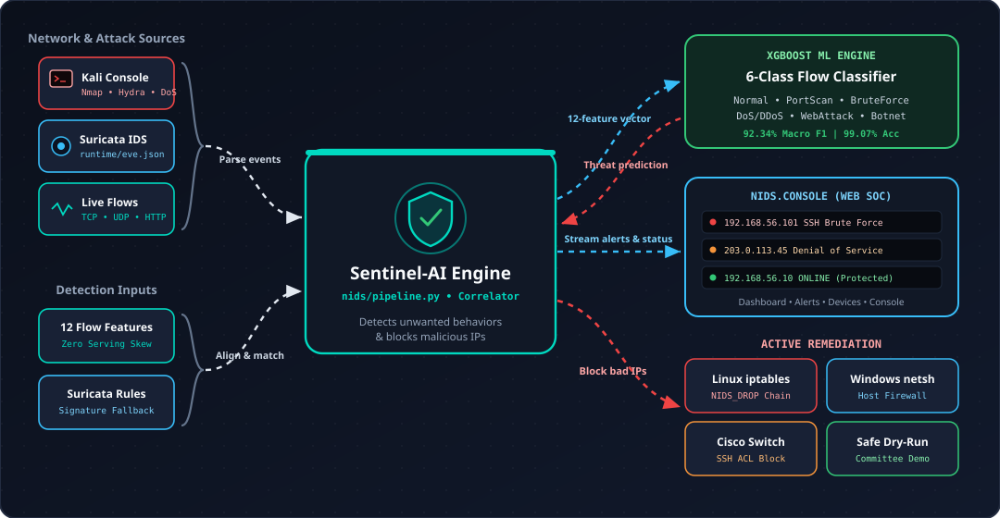

<p align="center">
  
</p>

<p align="center">
  
  
  
  
  
  <a href="https://github.com/ahmedramadan-bugs/Sentinel-AI-NIDS/actions"></a>
</p>

---

## How Sentinel-AI NIDS Works

<p align="center">
  
</p>

1. **Live Telemetry Collection:** `SuricataParser` tails `runtime/eve.json` in real time.
2. **Zero Train/Serving Skew:** `collectors/feature_alignment.py` extracts the exact **12 network flow features** used during training.
3. **Dual-Engine Detection:** **XGBoost** (`nids/ml.py`) classifies traffic across 6 classes while **Deterministic Rules** (`nids/rules.py`) act as a resilient fallback.
4. **Active Response & Visibility:** Threats are persisted in SQLite, viewed in the Web SOC (`Dashboard`, `Alerts`, `Topology`, `Console`, `AI Models`), and enforced via `ResponseEngine`.

---

## Live SOC Dashboard (`NIDS.CONSOLE`)

<p align="center">
  
</p>

---

## Quick Start: Demo Mode vs. Live Suricata

### Option A: Windows (`Windows_Support/`) — Instant Demo & Lab Mode
> Runs with `NIDS_RESPONSE_DRY_RUN=true` by default so you can safely test detection and blocking without modifying host firewall rules.

1. Open `Windows_Support/` and double-click **`start_nids.bat`** (or run `.\start_nids.ps1` in PowerShell). It automatically creates `.venv`, installs dependencies, and starts the server.
2. Open **`http://127.0.0.1:8080`** in your browser.
3. **Try it live from the UI (no external VM required):**
   - Go to **Console** in the sidebar → keep **Demo Simulator** selected → click **Connect**.
   - Click any playbook (**Nmap SYN Scan**, **Hydra SSH Brute Force**, **HPing3 SYN Flood**, or **SQL Injection Probe**).
   - Switch to **Dashboard**, **Alerts**, and **Topology (Network Devices)** to watch the attack appear, trigger AI/rule correlation, and mark the attacking IP in real time.

### Option B: Linux (`Linux_Support/`) — Production / Live Suricata Mode
1. **Install Suricata & load local rules** (if running live packet capture):
   ```bash
   sudo apt update && sudo apt install -y suricata
   sudo cp Linux_Support/suricata/nids-local.rules /etc/suricata/rules/
   # Ensure eve-log outputs to /var/log/suricata/eve.json (or set NIDS_EVE_LOG)
   ```
2. **Create virtual environment & start NIDS:**
   ```bash
   cd Linux_Support
   python3 -m venv .venv && source .venv/bin/activate
   pip install -r requirements.txt
   ./start_nids.sh
   ```
3. Open **`http://127.0.0.1:8080`**.

### Option C: Docker (`Linux_Support/Dockerfile`)
> **Note:** The Docker image packages the Python NIDS pipeline, ML model, and Web UI (`iptables` + `iproute2` included), **not** Suricata itself.
- **Live host capture:** Mount the host's Suricata log directory into the container via `docker-compose.yml` (e.g., `- /var/log/suricata:/app/runtime/suricata`) and point `NIDS_EVE_LOG` to the mounted `eve.json`.
- **Demo mode:** Run the container standalone and trigger simulated attacks from the **Console** page.

---

## AI Model Performance & Transparency

Trained on **CICIDS2017** (`AI/train_model.py`) with **deduplication before splitting** (`0%` train/test leakage) and leak-free preprocessing (`SimpleImputer` → `clip` → `log1p` → `StandardScaler` fitted on training data only). Evaluated on **31,118 clean test rows** (`99.07%` Accuracy, **`92.34%` Macro F1-Score**):

| Class | Precision | Recall | F1-Score | Test Support |
|---|---|---|---|---|
| `Normal` | `99.76%` | `98.35%` | `99.05%` | 14,988 |
| `Suspicious Port` | `99.93%` | `99.95%` | `99.94%` | 7,496 |
| `Denial of Service` | `99.57%` | `99.67%` | `99.62%` | 7,494 |
| `Brute Force` | `99.33%` | `99.86%` | `99.60%` | 739 |
| `Botnet` | `68.75%` | `96.39%` | `80.26%` | 194 |
| `Web Attack` | `61.52%` | `98.07%` | `75.61%` | 207 |

> **Class Imbalance Note:** Because `Botnet` (194 test rows) and `Web Attack` (207 test rows) are rare in CICIDS2017 compared to `Normal` (14,988 rows), the model intentionally prioritizes **High Recall (`96%–98%`)** to avoid missing real attacks, which produces some false positives on rare classes (`61%–69%` precision). In live operation, `NIDS_ML_CONFIDENCE_THRESHOLD=0.70` and Suricata signature correlation filter out low-confidence noise.

---

## Configuration (Environment Variables)

See [`.env.example`](./Windows_Support/.env.example) for the full template:

| Variable | Default | Purpose |
|---|---|---|
| `NIDS_EVE_LOG` | `runtime/eve.json` | Path to Suricata EVE JSON log |
| `NIDS_DATABASE` | `runtime/nids.db` | SQLite event store path |
| `NIDS_DASHBOARD_HOST` / `PORT` | `127.0.0.1` / `8080` | Web dashboard bind address |
| `NIDS_ML_CONFIDENCE_THRESHOLD` | `0.70` | Minimum ML confidence to act on a threat |
| `NIDS_RESPONSE_DRY_RUN` | `true` | `true` = simulate blocks safely; `false` = enforce real firewall rules |
| `NIDS_TEMP_BLOCK_SECONDS` | `300` | Duration for `TEMPORARY_BLOCK` actions |
| `NIDS_CISCO_HOST` / `USERNAME` / `PASSWORD` | *(unset)* | Optional Cisco switch SSH credentials for ACL blocking |

---

## Repository Structure & Tests

- [`Linux_Support/`](./Linux_Support) — Linux-compatible NIDS (`start_nids.sh`, `suricata_system_config/`, `Dockerfile`).
- [`Windows_Support/`](./Windows_Support) — Windows-compatible NIDS (`start_nids.bat`, `start_nids.ps1`).
- [`ARCHITECTURE.md`](./ARCHITECTURE.md) — System design and full REST API reference.
- [`LICENSE`](./LICENSE) — MIT License.

```bash
# Run unit & end-to-end tests inside Linux_Support/ or Windows_Support/
python -m pytest tests
```
