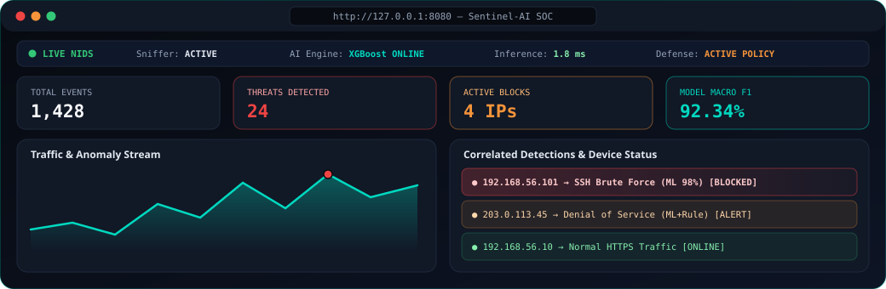
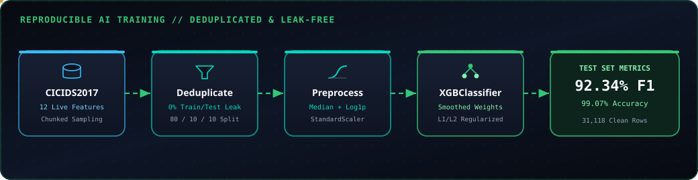

<p align="center">
  
</p>

<p align="center">
  
  
  
  
  <a href="https://github.com/ahmedramadan-bugs/Sentinel-AI-NIDS/actions"></a>
</p>

---

## Live SOC Dashboard Preview

<p align="center">
  
</p>

---

## How Sentinel-AI NIDS Works

<p align="center">
  
</p>

1. **Live Telemetry Collection:** `SuricataParser` tails `runtime/eve.json` in real time.
2. **Zero Train/Serving Skew:** `collectors/feature_alignment.py` extracts the exact **12 network flow features** used during training.
3. **Dual-Engine Detection:** **XGBoost** (`nids/ml.py`) classifies traffic across 6 classes (`Normal`, `Suspicious Port`, `Brute Force`, `Denial of Service`, `Web Attack`, `Botnet`) while **Deterministic Rules** (`nids/rules.py`) act as a resilient fallback.
4. **Active Response & Visibility:** Threats are persisted in SQLite, streamed to the Web SOC Dashboard (`Dashboard`, `Alerts`, `Topology`, `Console`, `AI Models`), and enforced via `ResponseEngine`.

---

## Reproducible AI Training Pipeline

<p align="center">
  
</p>

<details>
<summary><b>Committee Deep-Dive: Why our ML pipeline has 0% Data Leakage &amp; Zero Serving Skew</b></summary>

- **Dataset:** CICIDS2017 (`MachineLearningCVE`), streamed in `100,000`-row chunks.
- **Deduplication Before Split:** Exact duplicates on the 12 features and cross-class collisions are removed *before* `train_test_split`, guaranteeing zero identical flow vectors appear in both train (`80%`) and test (`10%`).
- **Leak-Free Preprocessing:** `SimpleImputer(strategy="median")` → `clip(>= 0)` → `log1p` → `StandardScaler` are fitted on the training split only.
- **Verified Test Metrics (`31,118` clean test rows):** `99.07%` Accuracy, `92.34%` Macro F1-Score (`AI/models/xgboost_nids_artifacts/metrics.json`).

</details>

---

## Repository Structure

| Folder | Target OS | What's Inside |
|---|---|---|
| [`Linux_Support/`](./Linux_Support) | **Linux (Ubuntu / Kali / Debian)** | Full NIDS with Suricata `eve.json` capture, `iptables`/Cisco response engine, and `.sh` / `.desktop` launchers. |
| [`Windows_Support/`](./Windows_Support) | **Windows 10 / 11** | Full NIDS with 1-click `.bat` & `.ps1` launchers, dry-run firewall mode, Demo Simulator Console, and live Network Devices view. |
| [`HANDOFF_PLAN.md`](./HANDOFF_PLAN.md) | **Team / Dev** | Architecture overview, API contracts, and development checklist. |

---

## Quick Start

### Windows (`Windows_Support/`)
1. Open `Windows_Support/` and double-click **`start_nids.bat`** (or run `.\start_nids.ps1` in PowerShell).
2. Open your browser at **`http://127.0.0.1:8080`**.

### Linux (`Linux_Support/`)
```bash
cd Linux_Support
python3 -m venv .venv && source .venv/bin/activate
pip install -r requirements.txt
./start_nids.sh
```
Open **`http://127.0.0.1:8080`** in your browser.

---

## Key Modules (Easy to Demo & Explain)

| Module | Purpose |
|---|---|
| `run_nids.py` & `nids/dashboard.py` | Lightweight Python `ThreadingHTTPServer` serving the UI & REST APIs |
| `nids/pipeline.py` & `nids/ml.py` | Core correlation loop (`Suricata` + `XGBoost` + `DeterministicRuleEngine`) |
| `nids/kali_console.py` & `web/js/console.js` | Kali Linux Console (Live SSH + Safe Demo Simulator Playbooks) |
| `nids/topology.py` & `web/js/topology.js` | Live Network Devices monitor (`Online`, `Offline`, `Attacking`, `Blocked`) |
| `AI/train_model.py` | Leak-free, reproducible XGBoost training script |

---

## Running Tests

```bash
# Inside either Linux_Support/ or Windows_Support/
pytest tests
```
